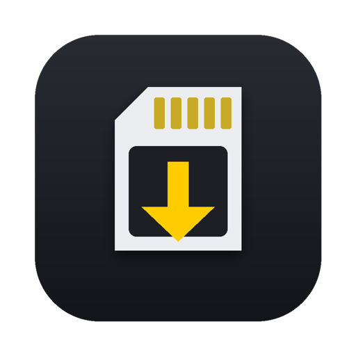
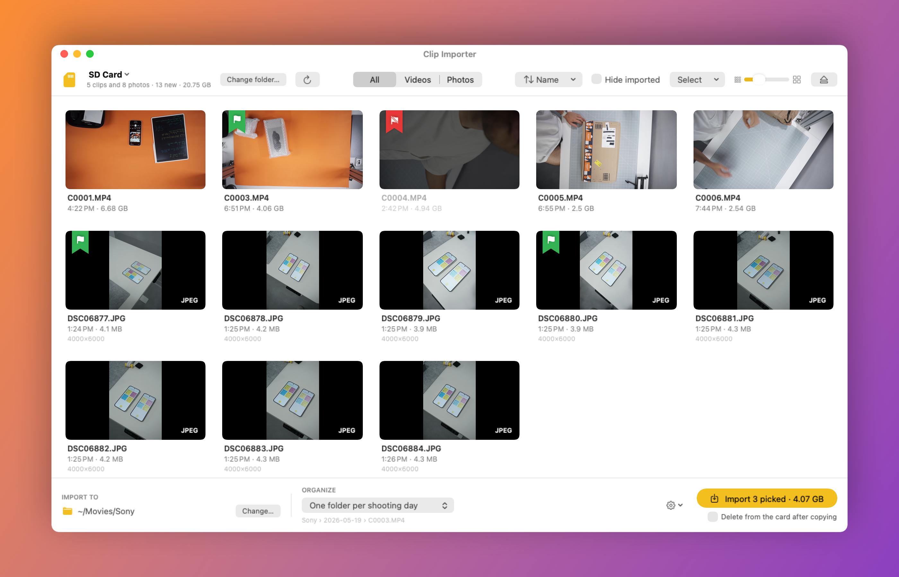

<div align="center">



# Clip Importer

### Importa video e foto dalla tua fotocamera Sony su Mac e Windows: l'alternativa gratuita e open source a PlayMemories Home

Inserisci la scheda SD, la finestra si apre da sola: scegli le clip, premi Importa. Fatto.

[](https://github.com/Sgnoogle/clip-importer/releases/latest/download/ClipImporter.zip)
[](https://github.com/Sgnoogle/clip-importer/releases/latest/download/ClipImporter-Windows-x64.zip)

🇬🇧 **[English README](README.md)**

<br>



</div>

## Installazione

### ⬇️ [Scarica Clip Importer (ZIP)](https://github.com/Sgnoogle/clip-importer/releases/latest/download/ClipImporter.zip)

Funziona su macOS 13 Ventura o successivi, sia con chip Apple sia Intel.

### Modo A: quello classico

1. Clicca il link qui sopra, poi fai doppio clic su `ClipImporter.zip` nella cartella Download per estrarlo.
2. Trascina **Clip Importer** nella cartella **Applicazioni**.
3. Aprila con un doppio clic. **La prima volta macOS la blocca** (vedi sotto): è normale.

**Perché macOS la blocca?** Apple fa aprire senza avvisi solo le app di sviluppatori che pagano l'abbonamento Apple Developer e le fanno "autenticare" da Apple. Clip Importer è un progetto gratuito e non lo è, quindi macOS dice che *"non può verificare che sia priva di malware"*. Il codice è tutto qui, leggibile da chiunque. Per permetterle di aprirsi, una volta sola:

1. Apri **Impostazioni di Sistema › Privacy e sicurezza**.
2. Scorri in basso: c'è scritto *"Clip Importer" è stata bloccata…*. Premi **Apri comunque** e conferma con la password o il Touch ID.

(Su macOS 14 e precedenti basta anche: clic destro sull'app › **Apri** › **Apri**.)

### Modo B: un solo comando, senza avvisi

Apri il **Terminale** (Applicazioni › Utility), incolla questa riga e premi Invio:

```sh
curl -fsSL https://raw.githubusercontent.com/Sgnoogle/clip-importer/main/install.sh | bash
```

Scarica l'ultima versione, la mette in Applicazioni e la apre. Rilanciala quando vuoi per aggiornare. ([Ecco cosa fa lo script](install.sh).)

### Windows

**[Scarica per Windows (x64)](https://github.com/Sgnoogle/clip-importer/releases/latest/download/ClipImporter-Windows-x64.zip)** · [ARM64](https://github.com/Sgnoogle/clip-importer/releases/latest/download/ClipImporter-Windows-arm64.zip) (solo per i portatili Snapdragon/Copilot+)

Windows 10 (1809 o successivo) o Windows 11. Estrai lo zip e fai doppio clic su `ClipImporter.exe`: non c'è niente da installare. La prima volta **Windows SmartScreen** avvisa che l'app non è firmata: premi **Ulteriori informazioni** e poi **Esegui comunque**. Stesse funzioni e stesse 10 lingue della versione Mac; vive nell'area di notifica vicino all'orologio. Scorciatoie: `Ctrl+C`, `Canc`, `Ctrl+I`, `Ctrl+Alt+I`, `F5`, `Ctrl+O`, `Ctrl+E`, `Spazio`, `P` / `X` / `U`. Per vedere le clip H.265 e le miniature RAW servono le estensioni gratuite **HEVC** e **Raw Image** del Microsoft Store.

### I permessi che chiede

| Quando | macOS chiede | Cosa rispondere |
|---|---|---|
| Alla prima scheda inserita | *"Clip Importer" vorrebbe accedere ai file su un volume rimovibile* | **Consenti**: serve per leggere la SD |
| Alla prima importazione in cartelle come Filmati o Documenti | L'accesso a quella cartella | **Consenti** |
| Se è attivo l'avvio all'accesso | Un avviso negli Elementi di login | Niente da fare (si toglie dalle opzioni dell'app) |

Se hai premuto "Non consentire" per sbaglio: **Impostazioni di Sistema › Privacy e sicurezza › File e cartelle › Clip Importer** e attiva *Volumi rimovibili*.

### Compilarla da sé

1. Apri il **Terminale**, scrivi `git clone https://github.com/Sgnoogle/clip-importer.git && cd clip-importer` e premi Invio (oppure, dallo zip, `cd ` + trascina la cartella `Codice sorgente`).
2. Scrivi `bash build.sh` e premi Invio.

Se il Mac chiede di installare gli "Strumenti da riga di comando", accetta e, al termine, rilancia `bash build.sh`. Lo script compila l'app, la mette in **Applicazioni** e la apre. Per rifare lo zip con l'app pronta: `bash pacchetto.sh`.

## Da quel momento
- c'è un'icona a forma di scheda SD nella barra dei menu in alto;
- parte da sola quando accendi il Mac (si può disattivare dalle opzioni);
- quando inserisci una scheda con clip o foto, la finestra si apre da sola.


## Come si usa

- **Clic** seleziona una clip (un altro clic la deseleziona), **⌘ clic** ne aggiunge/toglie altre, **⇧ clic** seleziona un intervallo, **⌘A** tutte.
- Le etichette sono **segnalibri** che pendono dal bordo della miniatura, ben distinti dal cerchio della selezione. Passando il mouse su una clip compare il **segnalibro vuoto**: **clic** = scelta (verde), un altro clic la toglie; **⌥ clic** = scartata (rossa); **clic destro** sul segnalibro = menu. Oppure i tasti P, X e U. Le scartate diventano in bianco e nero. Quando selezioni qualcosa, sotto il nome della scheda compaiono i tasti utili.
- Il cerchio in alto a destra della miniatura aggiunge/toglie la clip senza tasti.
- **Passa il mouse sulla miniatura** da sinistra a destra per scorrere dentro la clip.
- **Doppio clic** riproduce la clip.
- **Etichette, come in Lightroom**: **P** segna la clip come scelta ✔️, **X** come scartata ✖️, **U** toglie l'etichetta (premere di nuovo lo stesso tasto la toglie). Con **← →** passi alla clip precedente/successiva (⇧ allarga la selezione), quindi si fa tutto da tastiera.
  - Le scartate ✖️ diventano sbiadite e **non vengono mai importate**.
  - Se ci sono clip nuove segnate ✔️ e non hai selezionato niente, il pulsante importa **solo le scelte** («Importa le 5 scelte»).
  - Menu **Etichette**: seleziona le scelte o le scartate, ed **Elimina le scartate dalla scheda** (⌥⌘⌫), per le clip da 2 secondi registrate per sbaglio.
  - Le etichette restano anche togliendo e reinserendo la scheda.
- **Spazio** (o ⌘Y): anteprima rapida delle clip/foto selezionate, come nel Finder; le frecce scorrono tra quelle selezionate, Esc chiude.
- **⌘C** mette negli appunti i file selezionati (con il RAW abbinato, e l'XML se è attiva l'opzione): nel Finder **⌘V** li copia, **⌥⌘V** li sposta togliendoli dalla scheda. Per spostare conviene però ⌥⌘I nell'app, che verifica le copie e pulisce anche miniature, proxy e indice della fotocamera. Le clip si possono anche **trascinare** nel Finder o in DaVinci Resolve.
- **⌘⌫** (o ⌫) elimina le clip selezionate dalla scheda, insieme a XML, miniatura, proxy e RAW, e aggiorna l'indice della fotocamera. Chiede conferma e avvisa se qualcuna non è ancora stata importata. Da una cartella del Mac, invece, le manda nel Cestino.
- **⌥⌘R** mostra nel Finder le clip selezionate. **Esc** toglie la selezione.
- In alto, **Tutto · Video · Foto** sceglie cosa mostrare (e quindi cosa importare): quello che è nascosto non viene mai importato.
- Le foto scattate in **RAW + JPEG** compaiono una volta sola, con l'etichetta «RAW + JPEG»: si importano entrambi i file, con lo stesso nome. Le foto verticali si vedono intere.
- Le clip sono raggruppate per giorno, con "Seleziona giorno". Il menu **Ordina** (frecce in alto) le ordina anche per nome, durata o dimensione.
- Le clip già importate hanno la spunta verde e sono più chiare; "Nascondi importate" le toglie dalla vista.
- Se non selezioni niente, il pulsante importa **tutte le clip nuove**.
- **Importa in**: cartella di destinazione (di base `~/Movies/Sony`). **Organizza**: tutto insieme, una cartella per giorno di ripresa, la data di oggi o un nome a scelta.
- **Spostare invece di copiare** (come ⌘C e ⌥⌘V nel Finder): spunta **Cancella dalla scheda dopo la copia** sotto il pulsante, che diventa ✂️ «Sposta…». In alternativa tieni premuto **⌥** mentre clicchi, oppure usa **⌥⌘I**. Ogni file viene copiato, riletto dalla destinazione e confrontato byte per byte con l'originale: solo se è identico viene cancellato. Sulla scheda spariscono anche XML, miniatura, proxy e il RAW abbinato, e l'indice della fotocamera (`MEDIAPRO.XML`) viene aggiornato. Dalle cartelle del Mac gli originali vanno nel Cestino. Se la scheda ha la levetta LOCK inserita, le clip vengono importate ma restano sulla scheda.
- Ingranaggio: copia dei file XML, copia dei proxy (cartella `Proxy`, che DaVinci Resolve collega da solo), data nel nome dei file, espulsione della scheda al termine, apertura automatica, avvio all'accesso.

Le copie passano da un file temporaneo: se togli la scheda o annulli, non restano clip incomplete. Se una clip identica esiste già nella destinazione, non viene ricopiata.

## Schede supportate

- Sony XAVC S / HS / S-I (`PRIVATE/M4ROOT/CLIP`): durata, data e risoluzione vengono dai file XML Sony e le miniature sono istantanee.
- Sony AVCHD (`.MTS`): si importano, ma senza miniatura.
- MP4/MOV nella cartella `DCIM` (vecchie Sony e altre marche).
- Foto nella cartella `DCIM`: JPEG, HEIF (`.HIF`) e RAW (`.ARW` e i RAW delle altre marche). Data e risoluzione vengono dai dati EXIF.
- Qualsiasi cartella, con "Sfoglia una cartella…" (⌘O).

## Cartelle

- Per cambiare cartella in qualsiasi momento: pulsante **Cambia cartella…** in alto, ⌘O, oppure l'icona nella barra dei menu.
- Cliccando sul **nome della cartella/scheda** in alto si passa da una sorgente all'altra, si aggiorna, si apre nel Finder o si toglie una cartella dall'elenco.
- Le cartelle vengono **ricordate** (ultime 8) e all'avvio, se non c'è una scheda, si riapre l'ultima usata.
- La cartella aperta è **sorvegliata**: i video che ci arrivano compaiono da soli. ⌘R rilegge a mano.

## Disinstallare

Togli "Avvia all'accesso" dalle opzioni, esci dall'app dall'icona nella barra dei menu e cestina `Clip Importer` da Applicazioni.

## Crediti

Non so scrivere nemmeno una riga di codice: tutta l'app l'ha scritta [Claude](https://claude.ai) di Anthropic, una conversazione alla volta.

*Sgnoogle*

Licenza [MIT](LICENSE): libera da usare, modificare e condividere, per qualsiasi scopo.

<sub>Clip Importer è un progetto indipendente, non affiliato né approvato da Sony. Sony, Alpha, XAVC S, AVCHD, PlayMemories Home e Imaging Edge sono marchi dei rispettivi proprietari, citati solo per indicare la compatibilità.</sub>
