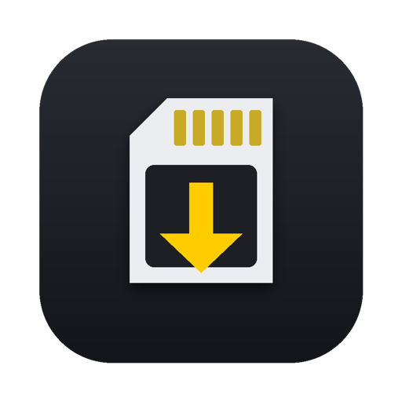
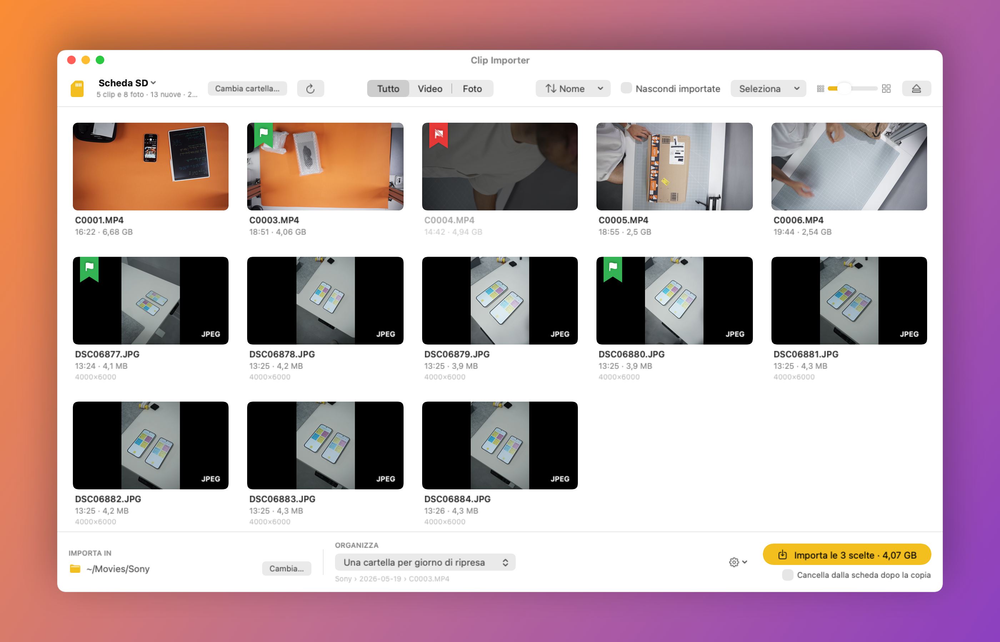

<div align="center">



# Clip Importer

### Import videos & photos from your Sony camera on Mac — the free, open-source PlayMemories Home alternative

Insert the SD card. The window opens by itself. Pick your clips, click Import. Done.

[](https://github.com/Sgnoogle/clip-importer/releases/latest/download/ClipImporter.zip)

[](#download--install)
[](#download--install)
[](https://github.com/Sgnoogle/clip-importer/releases/latest)
[](LICENSE)
[](Sources)

🇮🇹 **[Leggimi in italiano](LEGGIMI.md)**

<br>



</div>

<br>

## Why

If you shoot with a Sony camera and use a Mac, you've probably looked for **PlayMemories Home for Mac** — a simple way to see what's on the card and copy it to your computer, organized by date. Clip Importer is exactly that, rebuilt from scratch as a tiny, fast, native macOS app:

- no account, no catalog, no library to manage — just your files, copied where you want them;
- it understands Sony's card structure (`PRIVATE/M4ROOT`, XAVC S / HS / S-I, AVCHD, `DCIM`), so you see real clips instead of a maze of folders, XML and thumbnail files;
- it lives quietly in the menu bar and pops up when you insert a card.

## Features

| | |
|---|---|
| 🎬 **Sony video** | XAVC S, XAVC HS, XAVC S-I (`.MP4` in `PRIVATE/M4ROOT/CLIP`) with instant thumbnails, duration, resolution and frame rate read from Sony's XML metadata. AVCHD (`.MTS`) too. |
| 📷 **Photos** | JPEG, HEIF (`.HIF`) and RAW (`.ARW`, plus other brands' RAW). **RAW + JPEG pairs appear as one item** and are imported together with matching names. |
| 🗂 **Show what you need** | All · Videos · Photos. Grouped by shooting day, sortable by name, duration or size. |
| 👀 **Preview** | Hover over a clip to scrub through it, press **Space** for Quick Look, double-click to play. |
| 🔖 **Flags, Lightroom-style** | Hover a thumbnail and click the bookmark to **pick** it (⌥-click to **reject**), or use `P` / `X` / `U` and `←` `→`. Rejected items are never imported; if you picked some, the button imports only the picks. |
| ✂️ **Copy or move** | "Move" copies each file, **re-reads it from the destination and compares SHA-256 hashes**, and only then deletes it from the card — together with its XML, thumbnail, proxy and its entry in Sony's `MEDIAPRO.XML` index, so the camera doesn't complain. |
| 📁 **Organize** | One folder per shooting day, today's date, a custom name, or everything together. Optionally add date and time to file names. |
| 🎞 **Editor-friendly** | Optionally copy Sony XML sidecars and **proxies** into a `Proxy` folder that DaVinci Resolve links automatically. Drag clips straight into Finder or your timeline. |
| 🛡 **Safe** | Copies go through temporary files (an unplugged card never leaves half files), identical files are skipped, already-imported clips are remembered and marked. |
| ⌨️ **Mac shortcuts** | `⌘C` then `⌘V`/`⌥⌘V` in Finder, `⌘⌫` delete, `⌘I` import, `⌥⌘I` import & delete from card, `⌘R` refresh, `⌘O` open folder, `⌘E` eject. |
| 🪶 **Lightweight** | ~3 MB, native SwiftUI, no dependencies, no tracking, no network access. |

## Download & install

### ⬇️ [Download Clip Importer (ZIP)](https://github.com/Sgnoogle/clip-importer/releases/latest/download/ClipImporter.zip)

macOS 13 Ventura or later · Apple silicon and Intel · free and open source.

### Option A — the usual way

1. Click the link above, then double-click `ClipImporter.zip` in Downloads to unzip it.
2. Drag **Clip Importer** into your **Applications** folder.
3. Double-click it. **macOS will block it the first time** (see below) — that's expected.

**Why does macOS block it?** Apple only lets apps open without warnings if the developer pays for an Apple Developer account and has the app "notarized". Clip Importer is a free hobby project and isn't, so macOS says it *"cannot verify that it is free of malware"*. The full source code is right here for anyone to read. To allow it, once:

1. Open **System Settings › Privacy & Security**.
2. Scroll down: you'll see *"Clip Importer" was blocked…*. Click **Open Anyway** and confirm with your password or Touch ID.

(On macOS 14 and earlier you can also right-click the app › **Open** › **Open**.)

### Option B — one command, no warnings

Open **Terminal** (Applications › Utilities), paste this and press Return:

```sh
curl -fsSL https://raw.githubusercontent.com/Sgnoogle/clip-importer/main/install.sh | bash
```

It downloads the latest release, installs it in Applications and opens it. Run it again any time to update. ([See what the script does](install.sh).)

### Permissions it will ask for

| When | macOS asks | Answer |
|---|---|---|
| First card inserted | *"Clip Importer" would like to access files on a removable volume* | **Allow** — it needs to read the SD card |
| First import into a folder like Movies or Documents | Access to that folder | **Allow** |
| If "start at login" is on | A notice about Login Items | Nothing to do (turn it off in the app's settings if you like) |

Clicked "Don't Allow" by mistake? **System Settings › Privacy & Security › Files and Folders › Clip Importer** → turn on *Removable Volumes*.

## Compatibility

Clip Importer reads the standard folder structure Sony cameras write to the card, so it should work with any Sony camera that records **XAVC S / XAVC HS / XAVC S-I** or **AVCHD** video, and with JPEG / HEIF / RAW photos in `DCIM` — Alpha mirrorless (a6000-series, a7 / a7S / a7R / a9 / a1), ZV-series vlog cameras, FX cinema line, RX compacts and Handycam camcorders.

Tested so far with a **Sony α5100**. If you try it with another model, please [open an issue](https://github.com/Sgnoogle/clip-importer/issues) and say whether it worked — it helps others.

Any folder works too ("Browse a folder…", `⌘O`), including cards from other brands with MP4/MOV in `DCIM`.

## FAQ

**Is there a PlayMemories Home for Mac that works on recent macOS?**
Clip Importer covers what most people used PlayMemories Home for: seeing what's on the card and importing videos and photos into dated folders. It runs natively on macOS 13 Ventura through the latest macOS, on Apple silicon and Intel.

**How do I import XAVC S videos from a Sony camera to a Mac?**
Insert the SD card (or connect the camera in mass-storage mode), and Clip Importer shows the clips from `PRIVATE/M4ROOT/CLIP` with thumbnails and duration. Click **Import**. The `.MP4` files land in `~/Movies/Sony/<date>` (you can change both).

**Why do my Sony videos appear inside a "PRIVATE" folder in Finder?**
That's how XAVC S cards are organized: each clip has an `.MP4`, an XML metadata file, a thumbnail and sometimes a proxy in separate folders. Clip Importer puts them back together as a single clip.

**Can it delete clips from the SD card after importing?**
Yes — tick "Delete from card after copying", hold ⌥ on the Import button, or press `⌥⌘I`. Each file is verified byte-for-byte before it's deleted.

**What about Sony's official software?**
Sony's current desktop apps are part of [Imaging Edge](https://imagingedge.sony.net/en/ie-desktop.html) — great for RAW development and tethered shooting. Clip Importer is a much smaller tool focused only on getting clips and photos off the card quickly.

**Does it upload anything or need an account?**
No. It never connects to the internet. Everything stays on your Mac.

## Build from source

No Xcode project needed — just the Command Line Tools (`xcode-select --install`):

```sh
git clone https://github.com/Sgnoogle/clip-importer.git
cd clip-importer
bash build.sh       # builds, installs to /Applications and launches
bash pacchetto.sh   # builds the universal (arm64 + x86_64) release zip in ~/Downloads
```

The code is plain SwiftUI/AppKit in [`Sources/`](Sources):

| File | What it does |
|---|---|
| `AppDelegate.swift` | Menu bar item, main menu, window, keyboard shortcuts, Quick Look |
| `AppState.swift` | App state: sources, selection, flags, import, delete |
| `CardScanner.swift` | Detects camera cards, lists clips/photos, reads Sony XML and EXIF |
| `Importer.swift` | Copy with progress, verification, deletion, Sony index update |
| `Views.swift` | The SwiftUI interface |
| `Models.swift`, `FolderWatcher.swift` | Data types, formatting, FSEvents folder watching |

Issues and pull requests are welcome.

## Credits

I can't write a single line of code — this whole app was built by [Claude](https://claude.ai) (Anthropic), one conversation at a time. — *Sgnoogle*

## License

[MIT](LICENSE) — free to use, modify and share, for any purpose.

---

<sub>Clip Importer is an independent project, not affiliated with, endorsed by or sponsored by Sony Group Corporation. Sony, Alpha, α, XAVC S, XAVC HS, AVCHD, Handycam, PlayMemories Home and Imaging Edge are trademarks of their respective owners and are used here only to describe compatibility.</sub>
